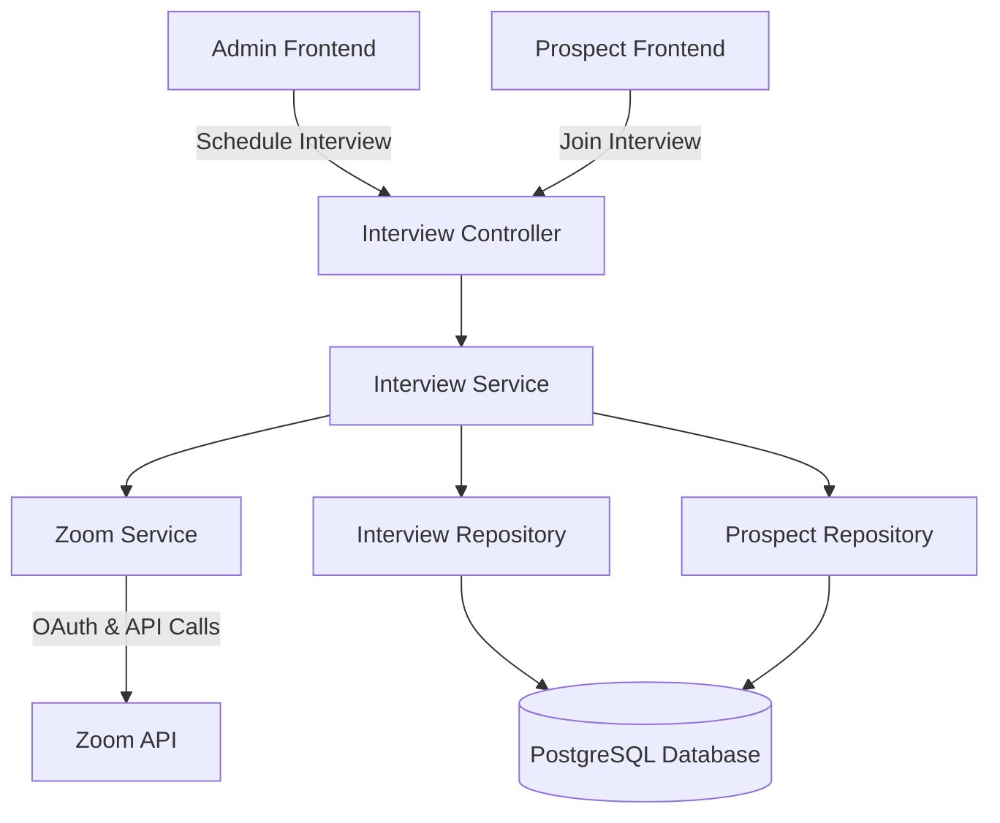

# Design Document

## Overview

This design document outlines the implementation of Zoom video conferencing integration for conducting admin interviews with prospective tutors. The solution uses Zoom's Server-to-Server OAuth for authentication and the Zoom REST API for meeting management. The implementation follows NestJS architectural patterns and integrates with the existing onboarding workflow.

## Architecture

### High-Level Architecture



### Module Structure

The implementation will create a new `interviews` module with the following structure:

```
src/modules/interviews/
├── interviews.module.ts
├── interviews.controller.ts
├── services/
│   ├── interviews.service.ts
│   └── zoom.service.ts
├── dto/
│   ├── schedule-interview.dto.ts
│   ├── interview-response.dto.ts
│   └── update-interview-status.dto.ts
└── interfaces/
    └── zoom-meeting.interface.ts
```

## Components and Interfaces

### 1. Zoom Service

**Purpose**: Handle all Zoom API interactions including authentication and meeting creation

**Key Methods**:
- `getAccessToken()`: Obtain OAuth access token using Server-to-Server OAuth
- `createMeeting(topic: string, startTime: Date, duration: number)`: Create a Zoom meeting
- `deleteMeeting(meetingId: string)`: Cancel a Zoom meeting (optional)

**Dependencies**:
- `axios` for HTTP requests to Zoom API
- Environment variables: `ZOOM_ACCOUNT_ID`, `ZOOM_CLIENT_ID`, `ZOOM_CLIENT_SECRET`

**Implementation Details**:
```typescript
interface ZoomMeetingResponse {
  id: string;
  topic: string;
  start_time: string;
  duration: number;
  start_url: string;
  join_url: string;
  password: string;
}

interface ZoomTokenResponse {
  access_token: string;
  token_type: string;
  expires_in: number;
}
```

**Authentication Flow**:
1. Encode Client ID and Client Secret as Base64
2. POST to `https://zoom.us/oauth/token?grant_type=account_credentials&account_id={ACCOUNT_ID}`
3. Include `Authorization: Basic {base64_credentials}` header
4. Cache token until expiration (typically 1 hour)

**Meeting Creation**:
1. Obtain valid access token
2. POST to `https://api.zoom.us/v2/users/me/meetings`
3. Include meeting configuration (topic, start_time, duration, settings)
4. Return meeting details including URLs and password

### 2. Interview Service

**Purpose**: Business logic for scheduling and managing interviews

**Key Methods**:
- `scheduleInterview(userId: number, startTime: Date)`: Schedule interview for pending prospect
- `getInterviewByUserId(userId: number)`: Retrieve interview details
- `getInterviewById(id: number)`: Retrieve interview by ID
- `updateInterviewStatus(id: number, status: InterviewStatus)`: Update interview status
- `getHostStartUrl(interviewId: number)`: Get admin's meeting start URL
- `getParticipantJoinUrl(interviewId: number)`: Get prospect's join URL

**Business Rules**:
- Only prospects with status "pending" can have interviews scheduled
- One active interview per prospect (check for existing scheduled interviews)
- Interview duration defaults to 60 minutes
- Meeting topic format: "Interview with {prospect.fullName}"

**Validation Logic**:
```typescript
async validateProspectForInterview(userId: number): Promise<Prospect> {
  const prospect = await this.prospectRepository.findOne({
    where: { userId, status: ProspectStatus.PENDING }
  });
  
  if (!prospect) {
    throw new NotFoundException('Pending prospect not found for this user');
  }
  
  // Check for existing scheduled interview
  const existingInterview = await this.interviewRepository.findOne({
    where: { userId, status: InterviewStatus.SCHEDULED }
  });
  
  if (existingInterview) {
    throw new BadRequestException('Interview already scheduled for this prospect');
  }
  
  return prospect;
}
```

### 3. Interview Controller

**Purpose**: HTTP endpoints for interview management

**Endpoints**:

1. **POST /interviews/schedule-interview**
   - Body: `{ userId: number, startTime: string }`
   - Auth: Admin only (RolesGuard)
   - Response: Interview details with meeting URLs
   - Requirements: 1.1, 1.2, 1.3, 1.4, 1.5

2. **GET /interviews/user/:userId**
   - Params: userId
   - Auth: Admin or authenticated user (own data)
   - Response: Interview details
   - Requirements: 3.1, 3.2, 3.3, 3.4, 3.5

3. **GET /interviews/:id/host-url**
   - Params: interviewId
   - Auth: Admin only
   - Response: `{ hostStartUrl: string }`
   - Requirements: 4.1, 4.2, 4.4, 4.5

4. **GET /interviews/:id/join-url**
   - Params: interviewId
   - Auth: Authenticated user
   - Response: `{ participantJoinUrl: string }`
   - Requirements: 4.3, 4.4, 4.5

5. **PATCH /interviews/:id/status**
   - Params: interviewId
   - Body: `{ status: 'completed' | 'cancelled' }`
   - Auth: Admin only
   - Response: Updated interview
   - Requirements: 6.1, 6.2, 6.3, 6.4, 6.5

## Data Models

### Interview Entity (Existing - Review for Completeness)

The existing `Interview` entity already contains all necessary fields:

```typescript
@Entity('interviews')
export class Interview extends BaseEntity {
  @Column({ name: 'user_id' })
  @Index()
  userId: number;

  @ManyToOne(() => User)
  @JoinColumn({ name: 'user_id' })
  user: User;

  @Column({ type: 'timestamp', name: 'start_time' })
  startTime: Date;

  @Column({ type: 'varchar', length: 255, name: 'zoom_meeting_id' })
  zoomMeetingId: string;

  @Column({ type: 'text', name: 'host_start_url' })
  hostStartUrl: string;

  @Column({ type: 'text', name: 'participant_join_url' })
  participantJoinUrl: string;

  @Column({ type: 'varchar', length: 100, name: 'meeting_password' })
  meetingPassword: string;

  @Column({ 
    type: 'enum', 
    enum: InterviewStatus, 
    default: InterviewStatus.SCHEDULED 
  })
  @Index()
  status: InterviewStatus;
}
```

**Assessment**: The existing entity is complete and requires no modifications. All fields align with requirements 5.1-5.7.

### DTOs

**ScheduleInterviewDto**:
```typescript
export class ScheduleInterviewDto {
  @IsNumber()
  @IsNotEmpty()
  userId: number;

  @IsDateString()
  @IsNotEmpty()
  startTime: string; // ISO 8601 format
}
```

**InterviewResponseDto**:
```typescript
export class InterviewResponseDto {
  id: number;
  userId: number;
  startTime: Date;
  zoomMeetingId: string;
  hostStartUrl: string;
  participantJoinUrl: string;
  meetingPassword: string;
  status: InterviewStatus;
  createdAt: Date;
  updatedAt: Date;
}
```

**UpdateInterviewStatusDto**:
```typescript
export class UpdateInterviewStatusDto {
  @IsEnum(InterviewStatus)
  @IsIn([InterviewStatus.COMPLETED, InterviewStatus.CANCELLED])
  status: InterviewStatus;
}
```

## Error Handling

### Error Scenarios and Responses

1. **Prospect Not Found or Not Pending**
   - Status: 404
   - Message: "Pending prospect not found for this user"
   - Requirement: 1.2

2. **Interview Already Scheduled**
   - Status: 400
   - Message: "Interview already scheduled for this prospect"

3. **Zoom Authentication Failure**
   - Status: 500
   - Message: "Failed to authenticate with Zoom API"
   - Requirement: 2.3
   - Log: Full error details for debugging

4. **Zoom Meeting Creation Failure**
   - Status: 500
   - Message: "Failed to create Zoom meeting"
   - Log: Zoom API error response

5. **Interview Not Found**
   - Status: 404
   - Message: "Interview not found"
   - Requirement: 3.4

6. **Invalid Interview Status**
   - Status: 400
   - Message: "Cannot access meeting URLs for cancelled/completed interviews"
   - Requirement: 4.5

7. **Invalid Status Transition**
   - Status: 400
   - Message: "Invalid status transition"
   - Requirement: 6.5

### Error Handling Strategy

```typescript
try {
  // Business logic
} catch (error) {
  if (error instanceof NotFoundException || error instanceof BadRequestException) {
    throw error;
  }
  
  this.logger.error('Unexpected error in interview scheduling', {
    error: error.message,
    stack: error.stack,
    userId,
  });
  
  throw new InternalServerErrorException('Failed to schedule interview');
}
```

## Testing Strategy

### Unit Tests

1. **ZoomService Tests**
   - Mock axios for API calls
   - Test successful token retrieval
   - Test token caching and expiration
   - Test meeting creation with valid data
   - Test error handling for API failures

2. **InterviewsService Tests**
   - Mock repositories and ZoomService
   - Test prospect validation (pending status check)
   - Test duplicate interview prevention
   - Test successful interview scheduling
   - Test status update validation
   - Test URL retrieval with status checks

3. **InterviewsController Tests**
   - Mock InterviewsService
   - Test endpoint authorization (admin-only routes)
   - Test request validation (DTOs)
   - Test response formatting

### Integration Tests

1. **End-to-End Interview Scheduling Flow**
   - Create test prospect with pending status
   - Schedule interview via API
   - Verify database record creation
   - Retrieve interview details
   - Update interview status
   - Verify status transitions

2. **Zoom API Integration** (Optional - requires test account)
   - Test actual Zoom meeting creation
   - Verify meeting URLs are accessible
   - Test meeting cancellation

### Test Data

```typescript
const mockProspect = {
  id: 1,
  userId: 100,
  fullName: 'John Doe',
  status: ProspectStatus.PENDING,
  // ... other fields
};

const mockZoomMeeting = {
  id: '123456789',
  topic: 'Interview with John Doe',
  start_time: '2024-01-15T10:00:00Z',
  duration: 60,
  start_url: 'https://zoom.us/s/123456789?zak=...',
  join_url: 'https://zoom.us/j/123456789',
  password: 'abc123',
};
```

## Security Considerations

1. **Credential Management**
   - Store Zoom credentials in environment variables
   - Never expose credentials in API responses or logs
   - Use `.env` file for local development
   - Use secure secret management in production

2. **Authorization**
   - Only admins can schedule interviews
   - Only admins can access host start URLs
   - Users can only access their own interview join URLs
   - Implement RolesGuard for admin-only endpoints

3. **Data Validation**
   - Validate all input using class-validator
   - Sanitize user inputs to prevent injection attacks
   - Validate date formats and ranges

4. **Meeting Security**
   - Store meeting passwords securely
   - Use Zoom's waiting room feature (optional)
   - Enable meeting encryption in Zoom settings

## Configuration

### Environment Variables

Add to `.env` and `.env.example`:

```env
# Zoom Configuration
ZOOM_ACCOUNT_ID=lQagu1cGS_y1tAcpoG7SZA
ZOOM_CLIENT_ID=x5ZRY9xHTu6PXQ7xHn14NQ
ZOOM_CLIENT_SECRET=48jAC2VDYlZfXwrr3g12TiwN7MUgpLhs
```

### Zoom Meeting Default Settings

```typescript
const meetingSettings = {
  host_video: true,
  participant_video: true,
  join_before_host: false,
  mute_upon_entry: true,
  waiting_room: true,
  audio: 'both',
  auto_recording: 'cloud', // Optional: record interviews
};
```

## Integration Points

### 1. Onboarding Module Integration

The interviews module will integrate with the existing onboarding workflow:

- After a prospect submits their application, admins can schedule interviews
- The `GET /onboarding/tutors/list?status=pending` endpoint provides prospects ready for interviews
- After interview completion, admins can approve tutors via `POST /onboarding/tutor/:id/approve`

### 2. Frontend Integration

**Admin Dashboard**:
- Display list of pending prospects
- "Schedule Interview" button for each prospect
- Interview calendar/scheduler component
- "Start Interview" button that opens Zoom in new tab/iframe

**Prospect Dashboard**:
- Display scheduled interview details
- "Join Interview" button when interview time approaches
- Interview status indicator

### 3. Notification Integration (Future Enhancement)

- Send email notification to prospect when interview is scheduled
- Send reminder notifications before interview time
- Notify admin when prospect joins waiting room

## Performance Considerations

1. **Token Caching**
   - Cache Zoom access tokens to reduce API calls
   - Implement token refresh before expiration
   - Use in-memory cache or Redis for distributed systems

2. **Database Indexing**
   - Index on `userId` for fast prospect lookup
   - Index on `status` for filtering scheduled interviews
   - Composite index on `(userId, status)` for common queries

3. **API Rate Limiting**
   - Zoom API has rate limits (varies by plan)
   - Implement request throttling if needed
   - Handle rate limit errors gracefully

## Deployment Considerations

1. **Environment Setup**
   - Ensure Zoom credentials are configured in production environment
   - Verify Zoom account has necessary permissions
   - Test Zoom API connectivity from production servers

2. **Database Migration**
   - No migration needed (Interview table already exists)
   - Verify table structure matches entity definition

3. **Monitoring**
   - Log all Zoom API interactions
   - Monitor interview scheduling success rate
   - Alert on Zoom API failures

## Future Enhancements

1. **In-App Video Integration**
   - Embed Zoom meeting in application using Zoom Web SDK
   - Eliminate need to open external Zoom window

2. **Interview Recording Management**
   - Store recording URLs in database
   - Provide admin interface to review recordings
   - Automatic recording transcription

3. **Interview Scheduling UI**
   - Calendar-based scheduling interface
   - Check admin availability before scheduling
   - Automated scheduling based on prospect and admin availability

4. **Interview Feedback**
   - Admin feedback form after interview
   - Store interview notes and ratings
   - Link feedback to approval/rejection decision
